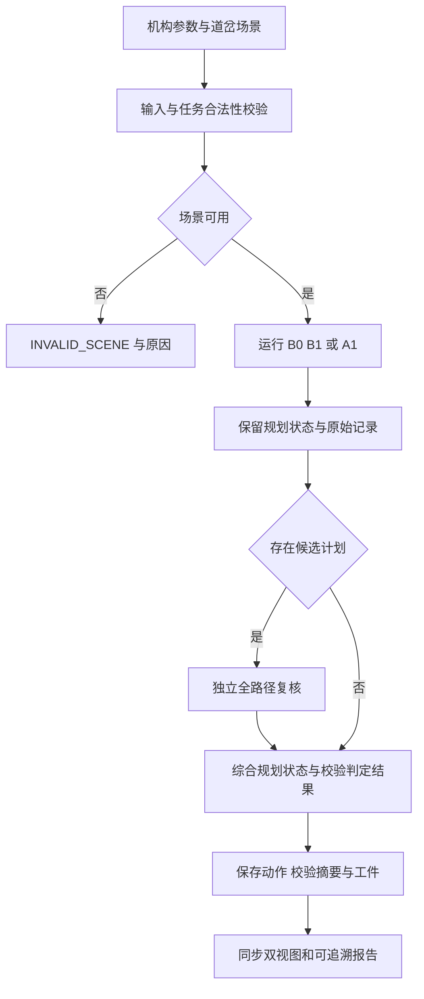

# CDC-16 捣固单元智能避障规划与虚拟仿真 AI Scientist 系统

面向道岔局部作业空间，研究具有横移、升降和翘镐能力的捣固单元，如何在机构约束下生成可解释、可复核的避障动作序列，并通过虚拟仿真和 AI Scientist 科研闭环比较规划方法、分析失败原因、形成可追溯报告。

项目以 **CDC-16 公开结构资料作为功能参考**，计划采用**简化三维几何模型、俯视图与横断面双视图、独立碰撞校验和同场景对照实验**。机械尺寸、行程、铰轴和间隙等未经可靠资料确认的参数，均属于可修改的示意假设。

> **当前状态：方向规划与文档更新阶段，尚未实现 CDC-16 捣固仿真子系统。** 仓库已有的可运行基础是二维栅格路径规划 AI Scientist 系统；下文明确标为“规划”的捣固模型、算法、工作台、接口和数据表均不是现成功能。本轮仅更新根目录 README，不代表已经完成任何捣固仿真实验。

> **适用范围：离线研究仿真、算法验证和软件演示。** 规划结果仅解释当前模型中的几何与动作可行性，不作为 CDC-16 实车控制指令或设备安全认证。

## 目录

- [1. 项目定位与研究问题](#1-项目定位与研究问题)
- [2. 当前能力与规划能力](#2-当前能力与规划能力)
- [3. 首版机械模型与场景范围](#3-首版机械模型与场景范围)
- [4. 总体架构与处理流程](#4-总体架构与处理流程)
- [5. 规划方法与独立校验](#5-规划方法与独立校验)
- [6. 双视图仿真与典型场景](#6-双视图仿真与典型场景)
- [7. 对照实验与评价指标](#7-对照实验与评价指标)
- [8. AI Scientist 科研闭环](#8-ai-scientist-科研闭环)
- [9. 技术栈与目录组织](#9-技术栈与目录组织)
- [10. 现有二维系统安装与运行](#10-现有二维系统安装与运行)
- [11. 分阶段建设与验收](#11-分阶段建设与验收)
- [12. 数据管理与适用边界](#12-数据管理与适用边界)
- [13. 相关文档与后续资料需求](#13-相关文档与后续资料需求)

## 1. 项目定位与研究问题

### 1.1 从二维路径规划到捣固机构动作规划

原系统研究二维栅格地图中的路径规划算法选型：输入地图与起终点，运行 A*、ACO、PSO、SA 和混合优化算法，记录实验、比较指标、验证候选假设并生成报告。

新方向研究的是具有体积和机构限制的机械单元。即使目标镐尖能够到达作业位置，其他镐、镐臂、镐腕或升降框架仍可能碰撞钢轨、护轨和轨枕；动作两端无碰撞，也不能证明翻转和横移的中间过程无碰撞。

| 比较项 | 现有二维系统 | 规划中的捣固系统 |
|---|---|---|
| 研究对象 | 地图中的移动点或栅格路径 | 固定车位下的单个捣固单元 |
| 状态 | 地图坐标 `(x_grid, y_grid)` | 横移、升降、让位镐翻转状态 `(y, z, theta)` |
| 障碍表达 | 二维不可通行栅格 | 钢轨、护轨、轨枕等三维几何代理体 |
| 动作 | 地图中的合法相邻移动或允许的路径段 | 受行程、姿态和示意互锁限制的机构动作 |
| 到达目标 | 到达地图终点 | 目标镐满足工作姿态、下插深度和目标区域条件 |
| 校验重点 | 起终点、越界、邻接与栅格碰撞 | 全构件碰撞、运动扫掠、间隙及目标约束 |
| 实验方法 | 五种二维算法对照 | B0/B1/A1 三种领域方法及自由度消融 |

原系统的实验追溯、随机种子、报告和研究闭环具有复用价值；原栅格算法的输入、运动语义和评价结果不能直接替代捣固机构规划。

### 1.2 四个核心研究问题

1. **可达性**：给定机构参数、固定车位和目标下插区，是否存在满足全部几何与动作约束的计划？
2. **结构能力贡献**：仅升降、横移加升降、横移加升降加翘镐，对有效目标达成率分别产生什么影响？
3. **规划方法贡献**：机构约束 A* 相比直接下插和固定动作策略，是否提高有效完成率，代价和耗时如何变化？
4. **结论可信性**：如何发现动作中途碰撞，并区分场景无效、离散模型无解、求解超时和几何精度不足？

预期面向路径规划、机械仿真与多智能体研究的开发者，以及需要理解避障动作及实验依据的演示和评审人员。

## 2. 当前能力与规划能力

### 2.1 已有的软件基础

当前代码位于 [CDC-16捣固单元智能避障规划与虚拟仿真AI科学家系统](CDC-16捣固单元智能避障规划与虚拟仿真AI科学家系统/README.md)。实际已有能力包括：

- 二维地图解析、生成、连通性检查与环境特征分析。
- A*、ACO、PSO、SA、混合优化算法的实验对照。
- `ApplicationService.run_cycle` 统一组织当前地图实验、评分、假设判断、反思和研究记录；`ScientificDiscoveryPipeline.run_full_cycle` 提供兼容包装。
- CLI、Streamlit GUI 和 FastAPI 三种入口；无参数 CLI 保留历史六智能体决策示例。
- 独立二维路径检验，区分算法自报成功与校验后成功。
- SQLite 原始运行与研究周期记录、随机种子管理、时间预算和报告追溯。
- 核心实验离线运行；GUI 可另行请求联网大模型文字解释，该解释不参与最终评分，仍需人工核验。
- 文献检索、事实抽取和受控入库等已有模块；文献检索尚未接入当前统一核心流程，不能将模块存在等同于闭环已全面接入。

### 2.2 捣固方向的计划能力

| 子系统 | 计划能力 | 当前状态 |
|---|---|---|
| 机械建模 | 一个框架、四把示意镐、单把让位镐翻转、横移与升降 | 规划，未实现 |
| 道岔场景 | 钢轨、护轨、轨枕、目标区及 S01～S05 示例 | 规划，未实现 |
| 几何与校验 | 三维节点碰撞、动作扫掠、目标判断、独立全路径复核 | 规划，未实现 |
| 规划器 | B0 直接下插、B1 固定动作策略、A1 机构约束 A* | 规划，未实现 |
| 仿真工作台 | 双视图同步、动作回放、首次干涉定位、方法对比 | 规划，未实现 |
| 实验评估 | 同场景对照、自由度消融、参数扰动、失败统计 | 规划，未实现 |
| 科研服务 | 领域假设、反思、人工复核和离线报告 | 规划，未实现 |
| 持久化与 API | 独立领域数据表、计划工件及 `/tamping/...` 接口 | 规划，未实现 |

本 README 中的架构、场景和验收要求是后续建设目标，不构成已取得的算法效果或设备性能结论。

## 3. 首版机械模型与场景范围

### 3.1 最小机械范围（规划）

首版采用固定车位、固定单元回转角下的局部模型：

- **一个捣固单元**：主框架、横移滑块、升降部件及相关连接件的简化碰撞体。
- **四把示意镐**：四把镐均可见且参与碰撞检查，同时表示镐尖及必要的镐臂、镐腕体积。
- **一个让位镐**：仅允许指定的一把镐改变翻转角，其余姿态固定。
- **分别指定目标镐和让位镐**：目标镐负责满足作业目标，让位镐用于研究局部避让能力，两者通过部件 ID 配置。
- **三个可控自由度**：横移 `y`、升降 `z` 和让位镐翻转角 `theta`；一次动作默认只改变一个自由度。

首版不模拟整车走行、多单元协同、回转自由度、液压阀控、振动夹持、道砟力学或现场作业控制。后续增加自由度时，需要同步扩展模型、动作语义和验收场景。

### 3.2 坐标、单位与状态（规划）

| 约定 | 定义 |
|---|---|
| 世界坐标 | 右手系；X 为线路纵向，Y 为线路横向，Z 竖直向上 |
| 长度 | 几何计算与接口位置统一使用 mm |
| 角度 | 计算内部使用 rad；输入若使用 deg，应在输入层显式转换 |
| 时间 | 使用 s；缺少真实速度依据时，不生成具有工程含义的动作持续时间 |
| 连续姿态 | `q = (y, z, theta)`，通过前向运动学得到各部件世界位姿 |
| 搜索状态 | `q_index = (i_y, i_z, i_theta)`，在有限步长和姿态集合中搜索 |

角度采样和动作互锁均为仿真模型的配置。例如离散角度集合不代表真实设备的机械档位；“升到一定高度才允许横移或翘镐”若缺少设备依据，只能标为示意互锁。

### 3.3 几何对象与目标区域（规划）

移动构件可先使用盒体、胶囊体等简化代理；钢轨、护轨采用拉伸截面近似实体，轨枕采用盒体。每个部件和障碍物应有唯一 ID，便于定位碰撞和复核记录。

**目标下插区是作业条件，不是不可穿越的实体障碍。** 首版将允许下插的道砟区域作为可进入区域，钢轨、护轨、轨枕及明确的禁入设备作为硬障碍；接触许可应按对象与部件明确区分。

对横移范围、升降行程、铰轴位置、镐体尺寸、目标容差和最小间隙等参数，计划记录数值、单位、来源类型、来源地址、说明和模型版本。未核实的数据统一标为 `illustrative` 或 `assumed`，不标称为 CDC-16 原厂数据。

## 4. 总体架构与处理流程

### 4.1 两个领域分开组织

现有二维系统继续使用原地图、五算法、评分口径和数据库表。后续在同一代码主线目录中新增独立 `tamping/` 子系统，建立专用模型、规划器、验证器、研究状态和服务接口。

| 层次 | 规划中的捣固职责 |
|---|---|
| 输入与配置 | 场景、机构参数、目标镐、让位镐、允许动作、预算与种子 |
| 领域模型 | 坐标变换、前向运动学、构件和障碍几何、限位及目标条件 |
| 规划与验证 | B0/B1/A1、状态和动作边检查、独立计划复核 |
| 应用服务 | 统一串联输入校验、规划、复核、结果保存和回放数据生成 |
| 研究与存储 | 对照实验、领域指标、假设反思、原始运行及报告 |
| 展示与接口 | 双视图工作台、动作回放和独立 REST 路由 |

### 4.2 单次规划处理流程（规划）



输入非法与规划无解采用不同语义：输入或初始状态无效应说明字段、部件或几何原因；无解、超时、精度不足属于正常规划结果，不能统一归为程序异常。

### 4.3 接口与数据设计（规划，尚不可调用）

计划使用 `TampingTask`、`TampingState`、`PlanResult` 和独立 `TampingResearchState` 表达领域任务、状态、规划结果和研究过程。规划器统一接收任务与预算，返回动作序列、运行耗时、状态码和校验信息。

`TampingApplicationService` 计划提供单任务仿真、对照实验和研究周期三类能力。原系统的二维输入类型及 `ResearchState` 字段不重新解释为机构参数。

| 计划接口 | 预期用途 |
|---|---|
| `GET /tamping/health`、`GET /tamping/scenes` | 子系统状态、模型版本及场景元数据 |
| `POST /tamping/validate-scene` | 检查输入、初始姿态和几何配置 |
| `POST /tamping/plan` | 生成计划及独立校验摘要 |
| `POST /tamping/benchmark` | 对同一场景集运行多方法实验 |
| `GET /tamping/plan/{plan_id}` | 查询动作、校验记录与回放工件 |
| `GET /tamping/report/{cycle_id}` | 查询研究报告 |

以上仅描述设计方向。本次未新增公共 API、数据类型、数据库迁移或运行入口。

## 5. 规划方法与独立校验

### 5.1 三种初期对照方法（规划）

| 编号 | 方法 | 行为与比较目的 |
|---|---|---|
| B0 | 直接下插 `DirectInsert` | 固定初始横移和姿态，仅改变 Z，定位传统下插的局部干涉 |
| B1 | 固定动作策略 `ScriptedSequence` | 按预设升高、必要时翘镐、横移、下插顺序尝试有限候选，不进行最优图搜索 |
| A1 | 机构约束 A* `ConstrainedAStar` | 在有限机构状态图中搜索，转移同时满足限位、互锁和三维动作边校验 |

三种方法须使用相同机构、场景、目标和校验标准。规划中的 `TAMPING_ALGORITHMS` 与现有二维五算法白名单分开；原 ACO、PSO、SA 和混合算法尚无捣固领域实现。

A1 初期按归一化横移距离、升降距离和翻转角变化累计非负动作成本。碰撞与超限属于硬约束，不能通过增加罚分放行。启发函数需证明是目标成本的下界；无法证明时，先使用 `h=0` 的 Dijkstra 基线保证搜索正确性。

### 5.2 节点、动作边与整条计划（规划）

1. **节点检查**：计算所有移动部件的三维位姿，检查行程、模式、禁入接触和几何间隙。
2. **动作边检查**：验证两个姿态之间的整个运动过程，包括镐臂、框架和翻转构件的扫掠区域。
3. **目标检查**：目标镐处于工作模式，镐尖进入目标区域并满足下插深度，其余部件同时符合硬约束。
4. **独立全计划复核**：规划器返回候选后，由解耦的校验器重新检查起点、相邻动作、每段运动及最终目标，不直接信任规划器的成功标记或缓存。

动作边计划采用可细化的自适应插值与保守位移上界：发现碰撞即拒绝；仅当间隙和保守界足以证明安全时通过；达到细分深度或精度限制仍无法判断时，返回 `INDETERMINATE`。

只有固定帧采样、没有保守界的检查，只能称为“采样检验通过”，不能宣称连续运动已获完整验证。数值容忍度 `collision_tolerance_mm` 与任务间隙要求 `required_clearance_mm` 分开记录。

### 5.3 规划状态与失败原因（规划）

| 最终状态 | 含义 | 解释边界 |
|---|---|---|
| `VALID_SUCCESS` | 独立状态、动作边及目标校验全部通过 | 对当前模型与精度配置有效，不是实车认证 |
| `NO_PATH_EXHAUSTED` | 已穷尽定义的有限状态图，未找到可行计划 | 仅代表当前离散模型；不能外推为连续空间无解 |
| `TIMEOUT` | 时间或定义的搜索资源预算耗尽 | 未能完成搜索，不代表机构不可达 |
| `INDETERMINATE` | 几何精度或尚未判定的动作边使结论不确定 | 不计为有效成功；不能据此宣称无解 |
| `INVALID_SCENE` | 输入、机构配置或初始状态不合法 | 应先修正场景，再讨论规划效果 |

动作诊断另记录 `JOINT_LIMIT`、`INTERLOCK_VIOLATION`、`COLLISION`、`GOAL_NOT_MET` 等原因，以及部件 ID、障碍 ID、动作索引和最小间隙。候选边碰撞不等于整个任务无解；只有满足穷尽条件且不存在影响结论的未决边时，才可返回 `NO_PATH_EXHAUSTED`。

## 6. 双视图仿真与典型场景

### 6.1 道岔捣固研究工作台（规划）

计划保留现有二维界面，新增独立工作台，提供以下区域：

- **参数区**：选择场景、目标镐与让位镐，配置自由度、机构行程、几何参数、搜索步长和校验预算。
- **俯视图 X-Y**：显示钢轨、护轨、轨枕、四镐投影、固定车位与目标作业区域。
- **横断面 Y-Z**：明确所选 X 截面，展示升降、翘镐、局部干涉和间隙；其他截面的障碍需另作提示。
- **动作控制区**：直接下插、固定动作和 A* 对照，支持播放、暂停、单步和时间滑块。
- **结果与解释区**：显示规划状态、首次失效动作、危险部件、原始步骤、模型假设及报告导出。

两图共享同一状态、动作时间参数和碰撞对象，图形只呈现几何引擎结果。**是否碰撞由三维计算决定，不能由二维投影重叠或视觉判断替代。** 可选三维预览属于后续扩展，不是首版前置条件。

### 6.2 五类验收场景（规划）

| 场景 | 主要构造 | 需要验证的性质 |
|---|---|---|
| S01 普通枕间 | 无需横移和翘镐即可下插 | B0 和 A1 均能通过独立校验 |
| S02 护轨局部干涉 | 直接下插受阻，调整姿态和位置后存在可行序列 | B0 失败，至少一条调整计划通过完整校验 |
| S03 旋转中途干涉 | 翻转起止姿态安全，中间扫掠碰撞 | 动作边被拒绝，证明没有只检查端点 |
| S04 行程内不可达 | 有限允许状态均不能满足目标 | 在足够预算和完整穷尽后返回 `NO_PATH_EXHAUSTED` |
| S05 预算或精度受限 | 分别构造低搜索预算与无法证明安全的几何情况 | 正确区分 `TIMEOUT` 和 `INDETERMINATE` |

场景应程序化构造、版本化保存并人工检查，不在界面或测试中硬编码“某方法一定成功”。每张场景卡计划展示模型来源、场景哈希、配置、自由度、规划状态和失败原因。

### 6.3 MVP 演示目标（尚未实现）

选择示意 S02 场景 → 运行直接下插并定位护轨干涉 → 运行 A1 得到调整动作 → 独立复核通过 → 双视图逐动作回放 → 导出含配置、校验摘要和局限的报告。

随后可关闭翘镐自由度重新求解，依据实际结果解释变化；若仍有其他可行计划，应如实显示，不预设“禁止翘镐必定失败”。

## 7. 对照实验与评价指标

### 7.1 实验矩阵（规划）

| 实验 | 比较内容 | 控制与记录要求 |
|---|---|---|
| E1 规划方法对照 | B0、B1、A1 的有效率、成本和耗时 | 同场景、同机构、同预算、同校验器；随机场景采用配对种子 |
| E2 自由度消融 | 仅升降；横移加升降；横移加升降加翘镐 | 固定算法、几何和目标，研究新增自由度的贡献 |
| E3 分辨率与鲁棒性 | 搜索步长、角度集合、校验精度、位置扰动和障碍膨胀 | 同时记录状态数量、有效率、间隙及不确定结果比例 |
| E4 失败分析 | 非法场景、固定动作碰撞、离散无解、超时和中途碰撞 | 保存可回放实例、失效动作与部件和障碍 ID |

### 7.2 领域指标（规划）

| 指标 | 定义或用途 |
|---|---|
| `valid_success_rate` | 独立复核通过且满足目标的次数 / 总测试次数 |
| `target_reach_rate` | 多目标实验中有效到达指定作业区的比例 |
| `minimum_clearance_mm` | 合法计划全过程的最小实体间隙，注明校验级别 |
| `action_count` | 合法动作段数量 |
| `travel_cost` | 按明示权重及状态变化计算的机构动作成本 |
| `planning_runtime_s` | 按固定计时范围记录规划及动作边检查耗时 |
| `timeout_rate` | 搜索预算耗尽结果所占比例 |
| `invalid_reason_breakdown` | 失败码、危险构件和障碍分布 |
| `clearance_robustness` | 参数或位置扰动下的有效成功率 |

评价顺序为：先满足硬约束和校验精度，再比较有效完成率，最后比较成本与耗时。不将碰撞计划的短路径计为优良结果，也不套用二维地图的指标含义和归一化区间。

### 7.3 可复现与统计要求（规划）

固定模型、场景集、算法版本、参数、预算和种子集合，保存场景及配置哈希。场景生成与算法采样采用可区分的种子来源；确定性搜索在相同条件下应得到相同状态路径，实际耗时允许受系统负载影响。

报告给出成功次数 `k/n`、失败分类及适当的区间估计，不静默剔除超时、无效计划和精度不足结果。单个演示场景不能支持普遍算法优劣结论；自由度贡献也仅适用于测试的示意参数与场景分布。

## 8. AI Scientist 科研闭环

### 8.1 逐步接入的原则（规划）

先通过确定性领域代码完成几何、约束、规划、校验和离线演示，再接入领域假设、实验编排、反思和报告服务。大模型可辅助解释和提出研究问题，几何硬约束的最终判断由确定性代码完成；无网络或无模型密钥时，核心流程仍应完整可用。

### 8.2 领域角色分工（规划）

| 角色 | 计划职责 |
|---|---|
| 场景分析 | 校验机构与道岔输入，分析狭窄区、目标偏置和被动镐干涉风险 |
| 约束检查 | 执行限位、示意互锁、接触许可和几何精度检查 |
| 知识检索 | 查询相似机构配置与场景的领域历史实验 |
| 假设生成 | 明确自变量、对照、指标、阈值、否证条件和实验计划 |
| 实验执行 | 在相同场景和预算下运行 B0/B1/A1 及消融实验 |
| 评估决策 | 只依据独立验证结果比较有效率、间隙、成本和耗时 |
| 反思与人工复核 | 检查参数来源、样本量、失败分类、未决几何和结论边界 |
| 报告解释 | 说明哪个部件、哪段动作发生干涉，关联运行 ID、哈希和校验记录 |

研究流程计划为：场景校验 → 历史依据与可证伪假设 → 对照实验 → 独立校验 → 原始记录 → 指标比较 → 反思与人工复核 → 回放和报告。

例如“允许翘镐能提高护轨干涉场景有效完成率”应作为待检验假设，保持其他条件相同，通过实验判断；新增自由度可能增大搜索空间，不能自动认定其在同预算下必然更优。

## 9. 技术栈与目录组织

### 9.1 现有技术与后续复用方向

| 类别 | 当前基础 | 捣固方向计划 |
|---|---|---|
| 计算与建模 | NumPy、SciPy、NetworkX | 数值变换、几何计算和有限状态搜索 |
| 用户界面 | Streamlit | 独立捣固研究工作台 |
| 图形展示 | Matplotlib、Plotly | 双视图、交互缩放和动作回放 |
| Web 服务 | FastAPI、Uvicorn、Pydantic | 领域输入输出契约与独立路由 |
| 数据管理 | SQLite、JSON | 独立 `tamping_*` 表及轨迹工件 |
| 语言模型 | Qwen 等可配置客户端 | 可选假设和文字解释辅助 |
| 报告工具 | python-docx、pandas、openpyxl 等 | 先提供 JSON/Markdown 离线研究报告 |
| 测试 | pytest | 几何、规划、状态语义及原系统兼容验证 |

现有直接依赖以 [requirements.txt](requirements.txt) 为准。首版不强制引入大型三维物理引擎；精细网格碰撞、CAD 和 Simscape Multibody 等属于后续评估项。

### 9.2 当前已存在的目录

下方以“仓库根目录”表示本地检出位置，根文件夹名称不影响内部模块布局。

```text
仓库根目录/
├── README.md
├── requirements.txt
├── CDC-16捣固单元智能避障规划与虚拟仿真AI科学家系统/   # 当前 Python 代码主线
│   ├── main.py                       # CLI
│   ├── config.py                     # 配置
│   ├── .env.example                  # 环境变量模板
│   ├── agents/                       # 二维研究服务与智能体
│   ├── algorithms/                   # 现有五算法
│   ├── map/                          # 二维地图处理
│   ├── evaluation/                   # 实验与路径校验
│   ├── gui/                          # Streamlit 界面
│   ├── api/                          # FastAPI 服务
│   ├── data/                         # 数据管理
│   ├── knowledge_base/               # 算法画像和历史知识
│   ├── literature/                   # 文献相关资料与模型
│   ├── llm/                          # 模型客户端
│   ├── reports/                      # 报告模块
│   ├── tests/                        # 既有自动化测试
│   ├── tools/                        # 验证和维护工具
│   └── utils/                        # 日志等辅助模块
├── docs/                             # 架构、路线图、竞赛和报告文档
├── evidence/validated_experiments/    # 已有二维实验资料
├── scripts/reports/                  # 报告生成与审计脚本
├── archive/legacy_trae/               # 历史文档归档
├── assets/                           # 本地大型资产，不提交
└── archive/legacy_backup/             # 本地历史备份，不提交
```

本地虚拟环境、密钥、数据库、日志和生成报告同样不属于应上传的项目代码。

### 9.3 捣固方向的规划结构（以下路径尚未建立）

```text
仓库根目录/
├── docs/tamping/                     # 规划：领域架构、来源台账、验证规范
└── CDC-16捣固单元智能避障规划与虚拟仿真AI科学家系统/
    ├── tamping/                      # 规划：独立领域包
    │   ├── domain/                   # 机构、运动学、几何、约束和目标
    │   ├── scenarios/                # 场景解析、工厂与 S01～S05
    │   ├── planners/                 # B0/B1/A1
    │   ├── evaluation/               # 独立校验、实验和领域指标
    │   ├── service/                  # 领域应用服务
    │   ├── agents/                   # 场景分析、假设和反思
    │   ├── storage/                  # 专用表与迁移
    │   ├── visualization/            # 双视图和动画
    │   ├── reports/                  # 领域报告
    │   ├── configs/                  # 示意参数和来源标签
    │   └── tests/                    # 领域测试
    ├── gui/tamping_workbench.py       # 规划：工作台
    └── api/tamping_router.py          # 规划：领域 API
```

这份结构不表示已有模块可导入，也不表示现在能启动捣固工作台。

## 10. 现有二维系统安装与运行

**本节命令仅用于仓库当前已实现的二维系统。** 捣固子系统暂未提供可执行启动命令。以下以 Windows PowerShell 为例，操作前进入仓库根目录；当前本地已有环境使用 Python 3.13.2，项目尚未建立完整的 Python 版本兼容矩阵。

### 10.1 新建本地环境

初次使用时，进入仓库根目录后执行：

```powershell
# 在代码主线下创建独立虚拟环境
python -m venv ".\CDC-16捣固单元智能避障规划与虚拟仿真AI科学家系统\.venv"

# 使用虚拟环境解释器安装仓库根目录的依赖
& ".\CDC-16捣固单元智能避障规划与虚拟仿真AI科学家系统\.venv\Scripts\python.exe" -m pip install -r ".\requirements.txt"

# 切换到代码主线；后续命令均从此目录执行
Set-Location ".\CDC-16捣固单元智能避障规划与虚拟仿真AI科学家系统"
```

已有可用环境时可直接进入代码主线，使用 `.\.venv\Scripts\python.exe`。显式调用解释器可避免误用系统环境，也不依赖激活脚本。若整个项目目录移动后旧环境不可用，可保留旧环境，使用系统 Python 在新的本地环境目录重新创建并安装依赖；相应替换下面命令的解释器路径。

### 10.2 离线运行与验证

```powershell
# 当前地图五算法实验与研究闭环
& ".\.venv\Scripts\python.exe" -B ".\main.py" --full

# 历史六智能体决策示例
& ".\.venv\Scripts\python.exe" -B ".\main.py"

# 既有自动化测试
& ".\.venv\Scripts\python.exe" -B -m pytest -p no:cacheprovider tests -q
```

`--full` 示例采用 30×30 地图、种子 42，每算法默认三次、每次一秒预算，并包含扰动评估。结果含地图哈希、运行记录、评分和离线状态，运行会产生本地实验数据或报告。该示例不包含捣固机构、三维碰撞或镐动作。

同一算法在相同种子下仍可能因时间预算和机器负载出现耗时或排名差异。当前协作式超时并非强制终止进程；总流程结束时还会检查整体预算。现有动态模式是在固定起终点的地图序列逐帧规划，不模拟机器人沿路径运动，也不代表真实机构动态控制。

### 10.3 启动现有 Streamlit GUI

在代码主线目录执行：

```powershell
& ".\.venv\Scripts\python.exe" -m streamlit run ".\gui\streamlit_app.py"
```

现有界面包含地图参数、环境分析、智能体推理和研究报告四个标签页。访问地址以终端输出为准，通常为 [本地 Streamlit](http://localhost:8501)。当前没有捣固研究工作台。

### 10.4 启动现有 FastAPI 服务

在另一个 PowerShell 窗口进入代码主线目录后执行：

```powershell
& ".\.venv\Scripts\python.exe" -m uvicorn api.server:app --host 127.0.0.1 --port 8000
```

启动后可查看 [API 交互文档](http://127.0.0.1:8000/docs) 和 [健康检查](http://127.0.0.1:8000/health)。

| 现有接口 | 行为 |
|---|---|
| `GET /health` | 返回服务健康状态 |
| `POST /analyze` | 调用统一服务完成二维地图研究流程 |
| `POST /experiment` | 返回 HTTP 202 和运行 ID，在后台执行实验 |
| `GET /experiment/{run_id}` | 查询实验状态及结果 |
| `GET /report/{run_id}` | 查询研究报告 |

`/analyze` 支持二维 `grid`，也可按尺寸、障碍率和种子生成地图。`/experiment` 为可比较性仍运行五种算法，`algorithms` 字段记录请求偏好。请求结构以当前 API 文档为准，`/tamping/...` 尚不存在。

### 10.5 可选模型配置与数据维护

离线核心实验不要求模型密钥。需要已有联网解释能力时，可在代码主线目录将 `.env.example` 复制为 `.env`，按模板填写模型供应商、端点、模型名和对应密钥；已有 `.env` 时保留现有文件，不覆盖。密钥仅保存在本地环境文件或受支持的 Streamlit secrets 中。

归一化基准重建、文献导入和复核属于维护操作，按需执行，不是每次启动所必需：

```powershell
# 重建二维评分参考基准；会写入基准数据
& ".\.venv\Scripts\python.exe" -B ".\tools\build_normalization_baseline.py"

# 文献导入暂存区与人工复核清单；--write 会写入数据
& ".\.venv\Scripts\python.exe" -B ".\tools\import_literature.py" --write
& ".\.venv\Scripts\python.exe" -B ".\tools\review_literature.py" --checklist
```

候选文献需人工复核后才能进入可信库，不能把检索结果或大模型抽取内容直接当作已确认的机械事实。

## 11. 分阶段建设与验收

以下全部为后续研发路线；**当前尚未完成捣固领域 P0，README 更新不计作阶段交付完成。** 代码开发计划在原仓库独立分支进行，阶段推进以验收结果为准。

### 11.1 P0～P6 阶段

| 阶段 | 主要建设内容 | 完成判据 |
|---|---|---|
| P0 工程保护与协议 | 记录起点提交、建立开发分支、原系统基线、资料台账及领域接口 | 原系统基线可复核；参数有来源分类；新域不依赖联网模型 |
| P1 几何与静态双视图 | 单元四镐、轨道与护轨简化模型、坐标变换、S01/S02 | 修改姿态后两图同步，构件世界位置与变换计算一致 |
| P2 约束与碰撞 | 限位、互锁、节点和扫掠校验、目标条件、独立验证器 | 中途碰撞和镐臂碰撞被拒绝；精度不足不误判成功 |
| P3 三方法规划 | B0/B1/A1、有限状态图、成本、预算和初期实验器 | S02 有有效调整计划；小图 A* 与 Dijkstra 成本一致；状态语义正确 |
| P4 MVP 工作台 | 参数配置、双视图回放、首次干涉、对比和本地导出 | 完整复现“直接下插失败→调整成功→独立复核→报告” |
| P5 科研服务与接口 | 领域研究状态、假设反思、专用表、API 和报告 | 每个结论可追溯；离线可运行；原接口及数据语义保持兼容 |
| P6 实验与交付 | E1～E4、冻结场景集、敏感性与失败分析、用户材料 | 领域验收和旧系统回归通过，报告数字均有原始运行依据 |

### 11.2 交付层级

| 层级 | 交付重点 |
|---|---|
| MVP，P0～P4 | 示意机构与场景、可信碰撞、三种规划方法、双视图演示和离线报告 |
| V1，P5～P6 | AI Scientist 领域闭环、原始实验追溯、API、持久化和系统实验 |
| V2，后续 | 多镐姿态、单元回转、多单元联合、可靠真实尺寸、复杂场景和精细三维仿真 |

### 11.3 必须覆盖的验收情形

- 坐标变换、横移升降和翻转结果与解析计算一致；负尺寸、混用单位和重复 ID 被拒绝。
- 镐尖到位但镐臂碰撞时失败；起终姿态安全但中途碰撞时失败；四把镐均参与几何检查。
- 不生成超行程或违反示意互锁的动作，所有候选最终经过独立全路径复核。
- 小规模完整状态图中验证搜索成本；无解、超时、精度不足和场景无效分别返回正确状态。
- 同场景、版本和种子下的确定性结果可复核，耗时变化如实记录。
- S01～S05 的预期性质可重复验证，双视图共享状态且有模型来源说明。
- 新领域模块、迁移和接口接入后，原二维 CLI、API 及既有测试保持兼容。

## 12. 数据管理与适用边界

### 12.1 现有实验可信性基础

| 机制 | 当前二维系统做法 |
|---|---|
| 原始运行 | `run_raw` 记录种子、耗时、自报与校验成功、失败原因和几何长度 |
| 扰动追溯 | `robustness_raw` 保存扰动运行，`map_grids` 保存输入地图 |
| 独立路径检验 | `evaluation/path_validator.py` 检查端点、邻接、越界和栅格碰撞 |
| 时间预算 | 配置按算力等级给出默认预算，可由环境变量覆盖；服务请求可使用明确预算 |
| 评分基准 | 预生成场景基准；缺失时降级为当批归一化并标注 |
| 受控文献 | 暂存、人工复核、可信库分开管理 |

这些机制是可借鉴的软件基础，不代表现有二维校验已经具备三维机构安全验证能力。

### 12.2 捣固记录与工件（规划）

计划以 `tamping_scenes`、`tamping_plans`、`tamping_action_checks` 等专用表保存场景、候选计划和逐动作检查，后续增加实验、原始运行和研究周期记录。保留旧表含义，不将二维地图字段重新解释为机械参数。

计划记录场景和模型版本、几何及配置哈希、算法版本、预算、种子、自报成功、有效成功、失败原因及校验级别。较大的轨迹或关键帧工件独立保存并记录哈希；没有可靠运动速度时，不虚构真实动作时长。

### 12.3 模型依据与结论边界

公开设备介绍可作为功能组织参考；相关文献和跨设备专利可帮助理解原理，不能据此认定为 CDC-16 的精确装配。示意几何、仿真行程、互锁和最小间隙不作为厂家数值或工程安全标准。

实验结论应同时注明适用场景、模型版本、参数假设、搜索分辨率和校验能力。尚未支持的几何情况、仅通过采样的动作或缺失来源的关键参数，必须保留限制说明和人工复核标记。

### 12.4 本地资产与提交约定

大型地图、论文原文、二进制报告和历史镜像保留在本地资产或备份目录；可复核的小型既有二维实验资料位于 `evidence/`，不作为 CDC-16 实验结果。

`.env`、Streamlit secrets、虚拟环境、运行数据库、日志及生成报告不提交；未核权的 CAD 和其他非公开机械资料也不上传。本次文档更新仅提交根目录 README，详细修改方案仍保留在本地。

## 13. 相关文档与后续资料需求

### 13.1 仓库已有资料

- [主系统说明](CDC-16捣固单元智能避障规划与虚拟仿真AI科学家系统/README.md)：现有二维系统的模块与入口。
- [项目文档目录](docs/README.md)：既有规划、竞赛和报告资料索引。
- [二维实验资料](evidence/validated_experiments/README.md)：历史验证数据及适用范围。
- [报告与审计脚本](scripts/reports/README.md)：报告生成、实验检查和审计工具。
- [资产分类清单](docs/PROJECT_INVENTORY.md)：代码、研究资料、交付件和生成物的分类。
- [二维比赛路线图](docs/ROADMAP_2D_GRID_COMPETITION.md)：原二维方向建设路线，不代表捣固阶段进度。
- [资产位置与恢复校验](docs/ASSET_MANIFEST.md)：本地大型资产的存放约定。
- [既有技术边界](docs/architecture/TECHNICAL_BOUNDARY.md)：原系统能力和适用范围说明。
- [历史文档归档](archive/legacy_trae/README.md)：早期方案与 GUI 规格。

上述历史资料保留原研究语境；与捣固新方向的能力和阶段划分应结合本 README 区分阅读。

### 13.2 后续优先补齐的机械资料

1. 对应版本的捣固单元装配、外形尺寸、四镐相对位置及翻转铰轴资料。
2. 横移、升降、翻转的实际行程和经正式资料确认的动作互锁。
3. 目标道岔型号的钢轨、护轨、轨枕及局部设备几何、坐标和可公开使用的数据。
4. 尺寸公差、位置误差及目标间隙定义，用于参数敏感性与稳健性研究。

在这些资料补齐并完成版本化核验前，优先完成示意模型下的 P0～P4：让一处护轨干涉工况能够从失败定位、约束规划、独立校验到双视图回放形成可复核演示，再推进科研闭环和更复杂机构。
